# FoodHub: Design Rationale

**Capstone Project – Design Quality Improvement (Intermediate).** Lõi xử lý đơn hàng cho ứng dụng Customer của FoodHub.

| Thông tin | Nội dung |
|---|---|
| Thành viên | Hung Dang Quang (tác giả commit trong repo) · *(bổ sung các thành viên khác nếu có)* |
| Phân công | *(bổ sung: ai phụ trách pattern / phần nào)* |
| Công nghệ | Kotlin 2.2.10, Gradle 9.4.1, JDK 17+; module `:core` (Kotlin/JVM thuần) và `:app` (Android, Jetpack Compose) |
| Phạm vi | C1, C2, C3, C4, C7 (bắt buộc) và **cả C5 lẫn C6** (bonus); state diagram (bonus) |
| Kết quả kiểm thử | 144 unit test, tất cả xanh; line coverage domain 97,7% (736/753 dòng, JaCoCo) |

**Quy ước.** Đường dẫn file viết tắt tính từ `core/src/main/kotlin/com/nemis/foodhub/` (ví dụ `order/OrderState.kt:56` là file `domain/order/OrderState.kt`, dòng 56; các file domain được ghi không kèm tiền tố `domain/`). File của module Android tính từ `app/src/main/java/com/nemis/foodhub/`. Test nằm ở `core/src/test/kotlin/com/nemis/foodhub/`. "Hình Ax" là sơ đồ ở Phụ lục A.

**Đối chiếu yêu cầu đề bài với tài liệu:**

| Yêu cầu đề bài | Mục trong tài liệu |
|---|---|
| D4: mỗi pattern có Vấn đề → Lựa chọn → Đánh đổi | 3.1 – 3.7 |
| Rubric Design Rationale: nêu được phương án đã loại bỏ | "Phương án đã loại bỏ" ở cuối mỗi mục 3.1 – 3.7 |
| Rubric Design Patterns: tránh over-engineering | 3.8 |
| D4 + mục 6 đề: bằng chứng SOLID, chỉ đúng vị trí trong code | 4.1 – 4.5 |
| D4 + mục 5 đề: kiến trúc MVVM | 2 |
| Mục 3 đề: các chức năng cốt lõi | 1.1 |
| D3: test cho từng pattern, coverage domain ≥ 70% | 5 |
| D4: hạn chế đã biết; Bảo vệ và Change Request | 6.1, 6.2 |
| D1: bộ UML | Phụ lục A |

## 1. Phạm vi và truy vết yêu cầu

### 1.1 Chức năng cốt lõi → nơi hiện thực

| Chức năng (mục 3 đề) | Lớp chính | File | Test tiêu biểu |
|---|---|---|---|
| Xem menu (kèm khu vực của nhà hàng) | `MenuRepository`, `MenuViewModel` | `repository/Repositories.kt`, `presentation/ViewModels.kt:57` | `CustomerFlowTest.menuViewModelListsRestaurantsAndTheirItems` |
| Thêm/bớt món trong giỏ | `Cart`, `CartEditor`, `CartViewModel` | `cart/Cart.kt`, `cart/CartEditor.kt` | `CartMementoTest.addingTheSameItemIncreasesItsQuantity` |
| Áp mã khuyến mãi | `PromoCode`, `PromoCatalog`, `PricingService` | `pricing/Pricing.kt` | `CheckoutTemplateTest.promoCodeReducesTheTaxableAmount` |
| Checkout 3 loại đơn | `DeliveryCheckout`, `PickupCheckout`, `ScheduledCheckout`; `CheckoutViewModel` dựng request từ giỏ + form | `checkout/CheckoutFlows.kt`, `presentation/ViewModels.kt:142` | `CheckoutTemplateTest` (18 test), `ViewModelTest.checkoutViewModelBuildsTheRequestFromTheCartAndTheForm` |
| Thẻ, ví, COD × 2 khu vực (VN, US) | `RegionFactory`, `VietnamRegionFactory`, `UsRegionFactory` | `region/`, `payment/Payment.kt` | `RegionFactoryTest` (11 test) |
| Theo dõi trạng thái realtime | `OrderEventPublisher`, `OrderTrackingViewModel` | `order/OrderEvents.kt`, `presentation/ViewModels.kt:259` | `OrderObserverTest`, `ViewModelTest.anEventThatArrivesWhileTheScreenOpensIsNotLost` |
| Thông báo push/SMS/email khi đổi trạng thái hoặc có khuyến mãi | `NotificationOrderListener`, `MultiChannelNotifier`, `PromoAnnouncer` | `notification/Notification.kt`, `data/channel/Channels.kt` | `NotificationBridgeTest` (7 test) |
| Xuất hóa đơn HTML, CSV (PDF bonus: chưa làm) | `InvoiceFormatter`, `ExportInvoiceUseCase` | `invoice/Invoice.kt`, `usecase/OrderUseCases.kt:102` | `CustomerFlowTest.invoiceIsRenderedInTheNotationOfTheOrdersRegion` |
| Lưu nháp, undo, khôi phục khi app đóng đột ngột | `Cart` (Memento + `SnapshotCodec`), `CartHistory`, `CartDraftRepository`, `FileCartDraftRepository` | `cart/`, `data/FileCartDraftRepository.kt` | `CartMementoTest` (20 test), `CartMementoTest.aDraftWrittenToDiskSurvivesTheProcess` |
| Quy tắc theo trạng thái đơn | `OrderState` và 6 lớp con | `order/OrderState.kt` | `OrderStateTest` (18 test) |

### 1.2 Các điểm đề bài còn mơ hồ và quyết định

| # | Điểm mơ hồ | Quyết định | Lý do |
|---|---|---|---|
| 1 | Đơn pickup không có DELIVERING | Pickup đi `PREPARING → DELIVERED`; không thêm trạng thái | Giữ đúng bảng trạng thái của đề; `OrderType.requiresCourier` quyết định nhánh |
| 2 | "Xác nhận" ở C4 hay CONFIRMED? | Checkout tạo đơn ở CREATED sau khi thanh toán thành công; CONFIRMED là nhà hàng xác nhận | Khớp "CREATED hủy miễn phí" và "CONFIRMED phí 10%" |
| 3 | COD mâu thuẫn với "đã thu tiền" | COD không thu lúc checkout (`PaymentReceipt.collected = false`), thu khi giao (`Order.Context.recordDelivery`); hủy COD: phí 0, hoàn 0; COD không hoàn tiền online | Không thu tiền thì không có gì để giữ phí hay hoàn |
| 4 | Đơn hẹn giờ | Dùng chung vòng đời với giao tận nơi; giờ hẹn cách hiện tại từ 30 phút đến 7 ngày | Khác biệt chỉ ở bước validate (`ScheduledCheckout`) |
| 5 | Cửa sổ hoàn tiền 24 giờ | `Clock` được inject; đúng 24h vẫn hợp lệ, quá 24h ném `RefundWindowExpiredException`; chỉ hoàn một lần | Test xác định, không phụ thuộc giờ hệ thống |
| 6 | Phí hủy 10% đặt ở đâu | Trong `ConfirmedState.cancel`; `CancelOrderUseCase` chỉ chuyển tiền | Quy tắc theo trạng thái thuộc về state |
| 7 | C2 và C5 dễ chồng lấn | Observer quyết định *ai được báo*, Bridge quyết định *báo bằng cách nào*; nối nhau qua `CustomerNotifier` | Hai vấn đề khác nhau, hai pattern khác nhau |
| 8 | Tồn kho khi hủy hoặc sửa đơn | Hủy đơn trả hàng về kho; sửa món đổi tồn kho theo kiểu all-or-nothing (`InventoryService.replace`), hết hàng thì đơn giữ nguyên | Kho phải khớp với các đơn còn hiệu lực |
| 9 | Giỏ hàng sau khi đặt, "khôi phục khi app đóng đột ngột" | Đặt thành công thì xóa giỏ, lịch sử undo và nháp; nháp được ghi ra file trong thư mục riêng của app và chỉ được đề nghị khôi phục khi giỏ đang trống | Process bị kill thì mọi thứ trong RAM mất; nháp trùng với giỏ hiện tại thì khôi phục là vô nghĩa |

## 2. Kiến trúc MVVM

### 2.1 Phân lớp, module và chiều phụ thuộc

| Lớp | Module / package | Thành phần | Được phép phụ thuộc vào |
|---|---|---|---|
| View | `:app` · `ui.ordering`, `ui.tracking` | `OrderingScreen` (menu, giỏ, form checkout), `OrderTrackingScreen` (theo dõi, sửa món, thao tác, giả lập nhà hàng/shipper/admin, hóa đơn, tin đã gửi) | ViewModel (qua `OrderingViewModels`, `OrderScreen`) |
| ViewModel | `:core` · `presentation` | `MenuViewModel`, `CartViewModel`, `CheckoutViewModel`, `OrderTrackingViewModel`, `InvoiceViewModel`, `SimulatorViewModel`, `NotificationLogViewModel` (kế thừa `BaseViewModel`) | Domain |
| Domain | `:core` · `domain.*` | entity, state, factory, checkout, facade, use case, **interface repository** | Chỉ JDK |
| Data | `:core` · `data` | `InMemoryOrderRepository`, `InMemoryMenuRepository`, `InMemoryCartDraftRepository`, `FileCartDraftRepository`, `SimulatedInventoryService`, `PushChannel`, `SmsChannel`, `EmailChannel`, `SentMessageLog` (cài `NotificationOutbox`) | Domain |
| Composition root | `:core` · `app.AppContainer` | Nơi duy nhất tạo lớp cụ thể và nối dây (constructor injection) | Tất cả |

Chiều phụ thuộc là **Presentation → Domain ← Data** (Hình A10). `:core` là module Kotlin/JVM không có Android plugin, nên về mặt build domain *không thể* import `android.*`, và toàn bộ 144 test chạy không cần emulator.

### 2.2 Đối chiếu ràng buộc MVVM (mục 5 đề)

| Ràng buộc | Cách đáp ứng | Bằng chứng |
|---|---|---|
| View chỉ hiển thị và chuyển sự kiện | Màn hình Compose chỉ `collectAsStateWithLifecycle()` và gọi phương thức của ViewModel. Form đặt món được gửi đi dưới dạng `CheckoutForm` thô; `CheckoutViewModel` mới dựng `CheckoutRequest` (khu vực lấy từ dữ liệu nhà hàng, giờ hẹn từ `Clock` được inject). Nút giả lập nhà hàng/shipper/admin đi qua `SimulatorViewModel`, danh sách tin đã gửi qua `NotificationLogViewModel`. Màn hình không import `app`, `data`, use case, facade, checkout, notification, và không tự bắt lỗi domain; `MainActivity` chỉ dùng `AppContainer` để tạo các lớp bọc ViewModel | `ui/ordering/OrderingScreen.kt:56-58`, `ui/tracking/OrderTrackingScreen.kt:48-51`; `ArchitectureTest.screensTalkOnlyToViewModels`, `ArchitectureTest.theActivityUsesTheContainerOnlyToCreateViewModels`, `ArchitectureTest.businessRulesAreNotInThePresentationLayer` |
| Domain thuần JVM, test không cần emulator | Domain không import `android.*` hay `kotlinx.coroutines` | `ArchitectureTest.domainIsPureJvm` |
| Data nằm ngoài cùng | `data` chỉ import domain | `ArchitectureTest.dataLayerDoesNotKnowPresentation` |
| Interface repository đặt ở domain (DIP) | `OrderRepository`, `MenuRepository`, `InventoryService` ở `repository/Repositories.kt`; `CartDraftRepository` ở `cart/CartEditor.kt:28`; `NotificationOutbox` ở `notification/Notification.kt:103` | `ArchitectureTest.domainDoesNotDependOnOuterLayers` |
| ViewModel không giữ View/Context; state qua observable | Constructor chỉ nhận abstraction và kiểu của domain; expose `StateFlow` của `UiState` bất biến | `ViewModelTest.viewModelsDependOnlyOnDomainTypes`; `ArchitectureTest.presentationDoesNotKnowTheDataLayerOrTheAndroidFramework` |
| Thay đổi trạng thái đi một chiều | Nút → `OrderTrackingViewModel.cancel()` → `OrderFacade.cancelOrder` → `Order.cancel()` → state mới → event → ViewModel ghi `StateFlow` → View vẽ lại | Hình A12, A14; `ViewModelTest.trackingStateStartsFromTheOrderAndFollowsDomainEvents` |

**Vòng đời trên Android.** `OrderingViewModels` và `OrderScreenViewModels` (`ui/LifecycleBridges.kt`) kế thừa `androidx.lifecycle.ViewModel` để bọc các ViewModel thuần JVM: giữ chúng qua xoay màn hình và chuyển `onCleared()` của framework xuống `BaseViewModel.onCleared()`, nhờ đó các subscription Observer được hủy khi rời màn hình. `OrderingViewModels` cho `CartViewModel` và `CheckoutViewModel` dùng chung một `CartEditor`, nên đặt hàng xong thì màn hình giỏ tự trống. `OrderScreen` gom 4 ViewModel của một đơn; `OrderScreenViewModels.bind()` trả `null` khi đơn không còn (đơn lưu trong RAM). Các lớp bọc không chứa state hay quy tắc nghiệp vụ và là nơi duy nhất ở `:app` chạm vào `AppContainer`. Nhà hàng, shipper và admin được giả lập qua `SimulatorViewModel`, ViewModel này gọi `OrderLifecycleService` và `PromoAnnouncer`.

## 3. Design patterns

Mỗi pattern trình bày theo cùng một khung: Vấn đề → Lựa chọn (bảng vai trò) → Bằng chứng → Đánh đổi → Phương án đã loại bỏ.

### 3.1 C1. State: vòng đời đơn hàng

**Vấn đề.** Sửa món, hủy và hoàn tiền thay đổi theo trạng thái; chuyển trạng thái sai phải bị từ chối rõ ràng; không được dùng chuỗi `if/when` khổng lồ trên enum.

**Lựa chọn.** `OrderState` **từ chối mọi thao tác theo mặc định** (`reject()` ném `IllegalOrderOperationException(status, operation, reason)`). Mỗi state con chỉ override đúng các thao tác được phép. `Order` ủy quyền mọi hành vi cho state hiện tại. Mỗi state công bố `OrderCapabilities`, nên ViewModel hiển thị nút theo dữ liệu từ domain, không tự lặp lại quy tắc.

| Vai trò | Lớp | Vị trí |
|---|---|---|
| Context | `Order` | `order/Order.kt:35` (ủy quyền ở dòng 81-90) |
| State (trừu tượng) | `OrderState` | `order/OrderState.kt:56` |
| Concrete State | `CreatedState`, `ConfirmedState`, `PreparingState`, `DeliveringState`, `DeliveredState`, `CancelledState` | `order/OrderState.kt:86-165` |
| Giao diện hẹp state được thấy | `OrderContext` | `order/OrderState.kt:34` |
| Nhãn mô tả (không chọn hành vi) | `OrderStatus` | `model/Models.kt:54` |

Bảng quy tắc của đề được cài đặt như sau:

| Trạng thái | Sửa món | Hủy đơn | Thao tác khác | Chuyển tiếp hợp lệ | Cài đặt |
|---|---|---|---|---|---|
| CREATED | Có | Miễn phí, hoàn 100% | — | `confirm` → CONFIRMED; `cancel` → CANCELLED | `CreatedState` |
| CONFIRMED | Không | Phí 10%, hoàn 90% | — | `startPreparing` → PREPARING; `cancel` → CANCELLED | `ConfirmedState` |
| PREPARING | Không | Không | — | `startDelivery` → DELIVERING (giao, hẹn giờ); `markDelivered` → DELIVERED (pickup) | `PreparingState` |
| DELIVERING | Không | Không | Xem vị trí courier | `markDelivered` → DELIVERED | `DeliveringState` |
| DELIVERED | Không | Không | Hoàn tiền trong 24h (một lần, chỉ đơn trả online); đánh giá 1–5 sao (một lần) | — | `DeliveredState` |
| CANCELLED | Không | Không | — | Không (trạng thái cuối) | `CancelledState` |

Ví dụ một state chỉ override thao tác nó cho phép (`order/OrderState.kt:101-115`):

```kotlin
object ConfirmedState : OrderState(OrderStatus.CONFIRMED) {
    override val capabilities = OrderCapabilities(canCancel = true,
        cancellationFeePercent = CANCELLATION_FEE_PERCENT_AFTER_CONFIRM)
    override fun startPreparing(ctx: OrderContext) = ctx.transitionTo(PreparingState)
    override fun cancel(ctx: OrderContext): CancellationResult {
        val fee = ctx.amountPaid.percent(CANCELLATION_FEE_PERCENT_AFTER_CONFIRM)
        val result = CancellationResult(fee = fee, refund = ctx.amountPaid - fee)
        ctx.transitionTo(CancelledState)
        return result
    }
}   // confirm, editItems, requestRefund, rate... rơi về reject() của lớp cha
```

**Bằng chứng.**

- `OrderStateTest.everyOperationOutsideTheAllowedSetIsRejectedWithoutSideEffects`: 8 thao tác × 6 trạng thái, 39 tổ hợp không hợp lệ đều ném `IllegalOrderOperationException`, không đổi trạng thái, không phát event.
- `deliveryOrderWalksTheWholeLifecycleInOrder`, `pickupOrderGoesFromPreparingStraightToDelivered`, `cancelInConfirmedCharges10PercentAndRefundsTheRest`, `refundIsStillAllowedAtExactly24Hours`, `refundAfter24HoursIsRejected`, `capabilitiesFollowTheBehaviourTable`.
- `ArchitectureTest.noBranchingOnOrderStatusAnywhereInTheDomain` quét mã nguồn domain, không tìm thấy `when/if` nào theo status. Mức khẩn cấp của thông báo là dữ liệu của enum (`OrderStatus.urgent`), không phải một phép so sánh.

**Đánh đổi.**

- Thêm 6 lớp và interface `OrderContext`. Đổi lại, thêm trạng thái mới chỉ cần một lớp và sửa state đứng trước nó.
- Các state là `object` không giữ dữ liệu (flyweight). `ArchitectureTest.noSingletonsInTheDomainExceptTheStatelessOrderStates` cấm `object` ở mọi chỗ khác trong domain.
- `PreparingState` kiểm tra `type.requiresCourier`. Đây là rẽ nhánh theo *loại đơn*, không theo trạng thái, và là cách ít lớp nhất để xử lý pickup.

**Phương án đã loại bỏ.** (1) Enum + `when` ở mọi nơi: đúng lỗi đề bài cảnh báo. (2) Bảng chuyển trạng thái dạng dữ liệu (`Map<Status, Set<Status>>`): chỉ biết được chuyển hay không, không gắn được hành vi như phí hủy hay cửa sổ hoàn tiền.

**Sơ đồ.** Hình A3 (class), Hình A13 (state diagram).

### 3.2 C2. Observer: theo dõi đơn thời gian thực

**Vấn đề.** UI, thông báo và analytics cùng phản ứng khi đơn đổi trạng thái; nguồn phát không biết ai đang nghe; phải xử lý đăng ký, hủy đăng ký và luồng.

**Lựa chọn.** `Order` chỉ giữ interface `OrderEventPublisher`. Sau mỗi lần chuyển trạng thái, nó phát `OrderStatusChanged` (kèm `capabilities` của state mới) **sau khi nhả lock** (`order/Order.kt:92-99`). Mỗi event mang `version` là số lần chuyển trạng thái của đơn.

| Vai trò | Lớp | Vị trí |
|---|---|---|
| Subject (abstraction) | `OrderEventPublisher` | `order/OrderEvents.kt:33` |
| Concrete Subject | `SynchronousOrderEventPublisher` | `order/OrderEvents.kt:47` |
| Observer | `OrderStatusListener` | `order/OrderEvents.kt:28` |
| Concrete Observer: UI | `OrderTrackingViewModel` | `presentation/ViewModels.kt:259` |
| Concrete Observer: thông báo | `NotificationOrderListener` | `notification/Notification.kt:85` |
| Concrete Observer: analytics | `OrderStatusCounter` | `order/OrderEvents.kt:83` |
| Sự kiện / handle hủy đăng ký | `OrderStatusChanged` / `Subscription` | `order/OrderEvents.kt:17`, `Subscription.kt:7` |

| Yêu cầu C2 | Cách giải | Test |
|---|---|---|
| UI, thông báo, analytics cùng phản ứng | Hai observer hệ thống đăng ký ở `AppContainer.kt:104-108`; ViewModel đăng ký qua `OrderFacade.track` | `uiNotificationAndAnalyticsAllReactToOneTransition` |
| Nguồn phát không biết ai nghe | `Order` chỉ biết `OrderEventPublisher`; publisher chỉ biết `OrderStatusListener` | `everySubscriberIsNotifiedAndThePublisherKnowsNoneOfThem` |
| Đăng ký / hủy đăng ký | `subscribe()` trả `Subscription`; lọc được theo `orderId`; ViewModel hủy trong `onCleared()`; listener có thể tự hủy giữa lúc nhận event. ViewModel đăng ký **trước** rồi mới đọc đơn; event và kết quả đọc (`Order.view()`, đọc trong cùng một lock) đều mang `version`, cái nào mới hơn thì được giữ, nên event đến đúng lúc mở màn hình không bị mất | `cancelledSubscriptionNoLongerReceivesEvents`, `aListenerMayCancelItselfWhileBeingNotified`, `ViewModelTest.onClearedUnsubscribesSoADestroyedScreenNeverUpdates`, `ViewModelTest.anEventThatArrivesWhileTheScreenOpensIsNotLost` |
| Luồng (thread) | Danh sách đăng ký là `CopyOnWriteArrayList`; phát event ngoài lock; listener lỗi bị cô lập; ViewModel ghi vào `StateFlow` (thread-safe) và View thu thập trên main thread, nên không cập nhật UI từ background thread | `publishingAndSubscribingFromManyThreadsLosesNothing`, `orderPublishesAfterReleasingItsLockSoListenersCanReadItFromAnotherThread`, `aFailingListenerDoesNotStopTheOthers`, `ViewModelTest.eventsFromABackgroundThreadAreSafelyReflectedInTheState` |

**Đánh đổi.**

- Listener được gọi đồng bộ trên thread của bên phát, nên listener chậm làm chậm bên phát. Chấp nhận ở quy mô này; có thể thêm dispatcher bất đồng bộ sau.
- Các thao tác không đổi status (sửa món, hoàn tiền, đánh giá) không phát event. Sau khi thao tác thành công, ViewModel đọc lại từ domain (`facade.getOrder`), nên luồng vẫn một chiều.
- Thêm trường `version` vào event và `OrderSummary` để xếp thứ tự giữa "đọc" và "nghe". Đây là cái giá của việc đăng ký trước rồi mới đọc; phương án ngược lại (đọc rồi mới đăng ký) đơn giản hơn nhưng có thể lỡ một event.
- Cùng kiểu `Subscription` (`Subscription.kt`) được dùng lại cho hai nguồn phát nhỏ khác: `CartEditor.observe` (giỏ hàng dùng chung giữa màn giỏ và checkout) và `NotificationOutbox.observe` (danh sách tin đã gửi).

**Phương án đã loại bỏ.** (1) Polling: chậm và tốn tài nguyên. (2) `LiveData` trong domain: làm domain phụ thuộc Android. (3) EventBus toàn cục: ẩn phụ thuộc, khó test.

**Sơ đồ.** Hình A4 (class), Hình A12 (sequence: đổi trạng thái → observers).

### 3.3 C3. Abstract Factory (+ Factory Method): thanh toán đa khu vực

**Vấn đề.** Mỗi khu vực cần một bộ `PaymentProcessor`, `TaxCalculator`, `InvoiceFormatter` đi cùng nhau; thêm khu vực mới không sửa code cũ.

**Lựa chọn.** Mỗi khu vực là một factory cụ thể tạo trọn bộ sản phẩm, nên không thể ghép VAT Việt Nam với hóa đơn Mỹ. `createPaymentProcessor(method)` là **Factory Method**: điểm vào cố định giao việc chọn processor cho hook `newPaymentProcessor`, rồi kiểm tra hợp đồng (đúng method, đúng currency).

| Vai trò | Lớp | Vị trí |
|---|---|---|
| Abstract Factory | `RegionFactory` | `region/Region.kt:21` |
| Concrete Factory | `VietnamRegionFactory`, `UsRegionFactory` | `region/vn/VietnamRegion.kt:20`, `region/us/UsRegion.kt:20` |
| Abstract Product | `PaymentProcessor`, `TaxCalculator`, `InvoiceFormatter` | `payment/Payment.kt:46`, `pricing/Pricing.kt:18`, `invoice/Invoice.kt:38` |
| Factory Method (creator + hook) | `createPaymentProcessor` + `newPaymentProcessor` | `region/Region.kt:23-31` |
| Client | `CheckoutProcess`, `RefundExecutor`, `EditOrderItemsUseCase`, `ExportInvoiceUseCase` | `checkout/`, `usecase/OrderUseCases.kt` |
| Tra cứu theo mã khu vực | `RegionRegistry` | `region/Region.kt:39` |

Hai họ sản phẩm (số liệu giả lập):

| Thành phần | Việt Nam (`VN`) | Hoa Kỳ (`US`) |
|---|---|---|
| Tiền tệ | VND, 0 chữ số thập phân | USD, 2 chữ số thập phân |
| Phí giao chuẩn | 15.000 VND | $3.99 |
| `TaxCalculator` | `VietnamVatCalculator`: VAT 10% | `UsSalesTaxCalculator`: sales tax 7% |
| Thẻ / ví (hoàn tiền được) | VNPay / MoMo | Stripe / ApplePay |
| COD (chỉ thanh toán, thu khi giao) | COD-VN | COD-US |
| `InvoiceFormatter` | Nhãn tiếng Việt, "1.234.000 VND" | Nhãn tiếng Anh, "$1,234.00" |

**Bằng chứng.**

- `RegionFactoryTest.vietnamFamilyUsesVndVatAndVietnameseInvoice`, `usFamilyUsesUsdSalesTaxAndEnglishInvoice`, `sameOrderIsPricedAndInvoicedDifferentlyPerRegion`.
- `factoryMethodRejectsAProcessorThatBreaksTheRegionContract`: một factory trả processor sai currency bị chặn ngay.
- `aNewRegionWithItsOwnCurrencyWorksEndToEndWithoutChangingExistingCode`: `JapanRegionFactory` (JPY, thuế và hóa đơn riêng) được định nghĩa hoàn toàn trong code test, rồi checkout và hủy đơn thành công qua code hiện có. `Currency` là value type chứ không phải enum, nên thêm JPY không phải sửa file nào.

**Đánh đổi.**

- Thêm một *loại sản phẩm* mới vào họ (ví dụ `ShippingCalculator`) phải sửa mọi factory. Đây là nhược điểm kinh điển của Abstract Factory; chấp nhận vì tập sản phẩm ổn định.
- `PaymentMethod` vẫn là enum và mỗi factory dùng `when` vét cạn trên nó. Thêm phương thức thanh toán mới phải sửa enum và hai factory. Đây là lựa chọn có chủ ý: mỗi khu vực *bắt buộc* phải quyết định gateway nào xử lý phương thức mới, và nếu quên thì trình biên dịch báo lỗi. Bằng chứng OCP vì vậy dùng kênh thông báo (4.2).
- Đăng ký khu vực mới vẫn cần một dòng ở `AppContainer`, và dữ liệu nhà hàng phải khai báo mã khu vực (`MenuRepository.regionOf`). Tầng Android không còn giữ bảng nhà hàng → khu vực nào.

**Phương án đã loại bỏ.** (1) Một factory với `when(region)`: vi phạm OCP. (2) Ba Strategy độc lập cho thuế, hóa đơn, thanh toán: cho phép ghép sai họ. (3) `ServiceLoader` để tự phát hiện khu vực: quá mức cần thiết.

**Sơ đồ.** Hình A5.

### 3.4 C4. Template Method: quy trình checkout

**Vấn đề.** Các bước cố định validate → tính giá → thanh toán → xác nhận → thông báo, nhưng mỗi loại đơn khác nhau ở một số bước.

**Lựa chọn.** `CheckoutProcess.checkout()` cố định thứ tự các bước và không override được (hàm Kotlin mặc định `final`). Năm bước chung là `private`. Loại đơn chỉ khác nhau ở ba hook.

| Vai trò | Lớp / phương thức | Vị trí |
|---|---|---|
| Abstract Class | `CheckoutProcess` | `checkout/CheckoutProcess.kt:81` |
| Template method | `checkout()` | `checkout/CheckoutProcess.kt:83-92` |
| Các bước chung (`private`) | `validate`, `calculatePrice`, `pay`, `confirm`, `notifyCustomer` | `checkout/CheckoutProcess.kt:96-157` |
| Hook | `validateTypeRules` (abstract), `deliveryFee` (mặc định 0), `placedMessage` (abstract) | `checkout/CheckoutProcess.kt:161-165` |
| Concrete Class | `DeliveryCheckout`, `PickupCheckout`, `ScheduledCheckout` | `checkout/CheckoutFlows.kt` |

```kotlin
fun checkout(request: CheckoutRequest): OrderConfirmation {
    val factory = services.regions.forRegion(request.regionCode)
    val ctx = CheckoutContext(request, factory, OrderId(services.ids.next()))
    validate(ctx)                                  // 1
    val price = calculatePrice(ctx)                // 2
    val receipt = pay(ctx, price)                  // 3
    val order = confirm(ctx, price, receipt)       // 4
    notifyCustomer(order)                          // 5
    return OrderConfirmation(order.id, order.status, order.capabilities, order.price, placedMessage(order))
}
```

| Bước | Phần chung (`CheckoutProcess`) | Giao tận nơi | Pickup | Hẹn giờ |
|---|---|---|---|---|
| 1. Validate | Giỏ không rỗng, cùng một nhà hàng, đúng tiền tệ khu vực, còn hàng, mã khuyến mãi hợp lệ | + bắt buộc địa chỉ | + không được hẹn giờ | + bắt buộc địa chỉ, giờ hẹn trong [+30 phút, +7 ngày] |
| 2. Tính giá | `PricingService` + `TaxCalculator` của khu vực | Phí giao chuẩn | Phí giao 0 | Phí giao chuẩn |
| 3. Thanh toán | Processor lấy từ `RegionFactory` | Giống nhau | Giống nhau | Giống nhau |
| 4. Xác nhận | Giữ kho, tạo `Order` ở CREATED, lưu; lỗi thì trả kho và hoàn tiền | Giống nhau | Giống nhau | Giống nhau |
| 5. Thông báo | `notifier.notifyOrderUpdate(placedMessage)` | "…delivered to your address" | "…Pick it up at the restaurant" | "…scheduled for <giờ>" |

**Bằng chứng.** `CheckoutTemplateTest.stepsRunInTheFixedOrderValidatePricePayConfirmNotify` (mỗi collaborator ghi lại bước đã gọi nó: kho, thuế, gateway, repository, notifier), `neitherTheTemplateNorItsFixedStepsCanBeOverridden` (reflection: `checkout` là `final`, 5 bước là `private`), `noStepAfterAFailedStepIsExecuted`, `pickupOrderHasNoDeliveryFee`, `scheduledOrderNeedsATimeBetween30MinutesAndSevenDaysAhead`, và hai test bù trừ: `paymentIsRefundedWhenStockDisappearsBetweenValidationAndConfirmation`, `stockIsReleasedAndPaymentRefundedWhenSavingTheOrderFails`.

**Đánh đổi.** Dùng kế thừa nên ba lớp con gắn chặt với lớp cha. Chấp nhận vì chỉ có ba biến thể và chúng khác nhau rất ít. Nếu số biến thể tăng hoặc cần ghép chéo (ví dụ hẹn giờ có phí riêng), nên chuyển sang Strategy cho từng hook. Năm bước chung là `private`, nên lớp con không thể bỏ qua kiểm tra tồn kho hay đổi thứ tự các bước; test quan sát thứ tự qua các collaborator mà từng bước gọi, thay vì override bước. Đổi lại, muốn thay một bước chung cho riêng một loại đơn thì phải thêm hook mới vào `CheckoutProcess`.

**Phương án đã loại bỏ.** (1) Một lớp checkout với `if (type == …)` ở từng bước. (2) Strategy cho từng bước: nhiều đối tượng nhỏ nhưng không có gì ép thứ tự các bước.

**Sơ đồ.** Hình A6 (class), Hình A11 (sequence đặt hàng).

### 3.5 C7. Facade: điểm vào đơn giản cho ViewModel

**Vấn đề.** ViewModel chỉ gọi một API mức cao cho checkout, không biết Inventory, Pricing, Payment, Notification; Facade không được thành God class.

**Lựa chọn.** `OrderFacade` có 8 phương thức; `DefaultOrderFacade` **chỉ ủy quyền**, không chứa quy tắc nghiệp vụ.

| Vai trò | Lớp | Vị trí |
|---|---|---|
| Facade | `OrderFacade` / `DefaultOrderFacade` | `facade/OrderFacade.kt:42`, `:54` |
| Client | `CheckoutViewModel`, `OrderTrackingViewModel`, `InvoiceViewModel` | `presentation/ViewModels.kt` |
| Subsystem (bị che) | 3 `CheckoutProcess` (che Inventory, Pricing, Payment, Notification), 4 use case, `OrderRepository`, `OrderEventPublisher` | `checkout/`, `usecase/`, `repository/` |

| Phương thức của Facade | Ủy quyền cho |
|---|---|
| `checkout(request)` | `CheckoutProcess` tương ứng `OrderType` |
| `cancelOrder` / `requestRefund` / `editOrderItems` | `CancelOrderUseCase` (đổi trạng thái, trả kho, hoàn tiền) / `RefundOrderUseCase` / `EditOrderItemsUseCase` (tính lại giá, đổi tồn kho) |
| `rateOrder` / `getOrder` | `Order.rate()` / `OrderSummary` dựng từ `Order.view()` qua `OrderRepository` |
| `exportInvoice` | `ExportInvoiceUseCase` |
| `track(orderId, listener)` | `OrderEventPublisher.subscribe` |

**Bằng chứng.** `OrderFacadeTest.facadeDoesNotKnowInventoryPricingPaymentOrNotification` (reflection: trường và chữ ký không chứa các kiểu đó), `facadeApiStaysSmall` (tối đa 8 phương thức), `oneCallPlacesAnOrderEndToEnd`, `fullCustomerJourneyThroughTheFacade`, và các test tồn kho qua facade: `cancellingAnOrderPutsItsItemsBackInStock`, `editingItemsMovesTheDifferenceInAndOutOfStock`, `anEditBeyondTheStockIsRejectedAndChangesNothing`.

**Đánh đổi.** Thêm một tầng gián tiếp; đổi lại ViewModel dễ test và domain thay đổi bên trong không ảnh hưởng UI. `OrderLifecycleService` và `PromoAnnouncer` (giả lập app Restaurant/Courier/Admin) cố ý nằm ngoài facade để facade không phình ra; màn hình demo gọi chúng qua `SimulatorViewModel`. Kho chỉ được chạm tới trong use case, nên facade vẫn không biết `InventoryService`.

**Phương án đã loại bỏ.** (1) ViewModel gọi thẳng từng service: lộ phụ thuộc. (2) Một `CheckoutService` chứa mọi logic: chính là God class.

**Sơ đồ.** Hình A7.

### 3.6 C5. Bridge: thông báo đa kênh (bonus, làm cùng C6)

**Vấn đề.** Loại thông báo (OrderUpdate, Promo, Urgent) và kênh (Push, SMS, Email) phát triển độc lập; tránh bùng nổ số lớp.

**Lựa chọn.** Hai cây phân cấp độc lập, nối bằng một tham chiếu: `Notification` (nói *gì*) giữ `NotificationChannel` (gửi *thế nào*). Định dạng riêng của kênh nằm ở kênh: SMS bỏ tiêu đề và cắt còn 160 ký tự, email thêm tiền tố `[FoodHub]`.

| Vai trò | Lớp | Vị trí |
|---|---|---|
| Abstraction | `Notification` | `notification/Notification.kt:25` |
| Refined Abstraction | `OrderUpdateNotification`, `PromoNotification`, `UrgentNotification` | `notification/Notification.kt:31-43` |
| Implementor | `NotificationChannel` | `notification/Notification.kt:16` |
| Concrete Implementor | `PushChannel`, `SmsChannel`, `EmailChannel` | `data/channel/Channels.kt` |
| Client | `MultiChannelNotifier` (qua interface `CustomerNotifier`) | `notification/Notification.kt:46`, `:56` |

| Phương án | Số lớp với 3 loại × 3 kênh | Thêm kênh thứ 4 | Thêm loại thứ 4 |
|---|---|---|---|
| Kế thừa theo tích (`PushPromo`, `SmsUrgent`…) | 9 | +3 lớp | +3 lớp |
| **Bridge (đã chọn)** | **6** (3 + 3) | **+1 lớp** | **+1 lớp** + 1 phương thức ở `CustomerNotifier` |

**Bằng chứng.** `NotificationBridgeTest.everyKindOfNotificationCanTravelOverEveryChannel`, `channelsFormatTheSameMessageTheirOwnWay`, `aBrokenChannelIsReportedAndDoesNotBlockTheOthers`, `aNewChannelIsOneNewClassAndNothingElseChanges`, `statusChangesBecomeUpdatesAndCancellationBecomesUrgent`.

**Quan hệ với C2.** `NotificationOrderListener` (Observer) quyết định *khi nào và ai* được báo; `MultiChannelNotifier` (Bridge) quyết định *báo qua kênh nào và bằng định dạng gì*. `PromoAnnouncer` (đại diện công cụ Admin) dùng cùng đường gửi này cho khuyến mãi. Các kênh giả lập ghi tin vào `SentMessageLog`, lớp này cài interface domain `NotificationOutbox` để `NotificationLogViewModel` hiển thị mà không biết kênh nào.

**Đánh đổi.** Thêm một tầng trừu tượng so với gọi thẳng kênh; chỉ có lợi khi cả số loại lẫn số kênh cùng tăng, điều mà đề bài nêu rõ.

**Phương án đã loại bỏ.** (1) Kế thừa theo tích: 9 lớp, bùng nổ. (2) Một lớp với `when(channel)`: vi phạm OCP.

**Sơ đồ.** Hình A8.

### 3.7 C6. Memento: nháp và undo giỏ hàng (bonus)

**Vấn đề.** Lưu và khôi phục snapshot giỏ hàng mà không phá encapsulation; nhiều bản backup, có giới hạn số lượng.

**Lựa chọn.** `Cart` tạo memento là **lớp lồng `private`**; bên ngoài chỉ thấy interface `CartSnapshot` với đúng một thuộc tính `takenAt`. Để nháp sống sót khi process bị kill, chính `Cart` (companion `SnapshotCodec`) chuyển snapshot thành chuỗi và ngược lại; repository chỉ lưu chuỗi mà không hiểu nội dung.

| Vai trò | Lớp | Vị trí |
|---|---|---|
| Originator | `Cart` | `cart/Cart.kt:36` |
| Memento | `Cart.Memento` (private) | `cart/Cart.kt:73` |
| Mã hóa memento (chỉ originator làm được) | `CartSnapshotCodec`, cài bởi `Cart.SnapshotCodec` | `cart/Cart.kt:28`, `:79` |
| Giao diện hẹp của Memento | `CartSnapshot` | `cart/Cart.kt:20` |
| Caretaker | `CartHistory` (undo có giới hạn), `CartDraftRepository` (nháp); cài đặt bền vững `FileCartDraftRepository` | `cart/CartEditor.kt:8`, `:28`; `data/FileCartDraftRepository.kt:17` |
| Điều phối | `CartEditor` | `cart/CartEditor.kt:39` |

| Yêu cầu C6 | Cách giải | Test (`CartMementoTest`) |
|---|---|---|
| Lưu / khôi phục snapshot | `createSnapshot()` / `restore()` | `restoreBringsBackExactlyTheSavedState`, `aSnapshotIsNotAffectedByLaterChangesToTheCart` |
| Không phá encapsulation | Memento là `private`; caretaker chỉ đọc được `takenAt`; `restore` và `encode` từ chối snapshot không do `Cart` tạo; chỉ `Cart` mã hóa/giải mã được | `theCaretakerSeesOnlyATimestampAndCannotForgeSnapshots`, `theEncodingRoundTripsAnyTextAndOnlyTheCartCanProduceOrReadIt` |
| Nhiều backup, có giới hạn | `CartHistory(capacity)`, mặc định 10 (`AppContainer.cartHistoryLimit`); đầy thì bỏ bản cũ nhất | `onlyTheNewestNBackupsAreKept`, `undoWalksBackThroughTheBackupsInReverseOrder` |
| Khôi phục khi app đóng đột ngột | Mỗi thay đổi *thành công* được lưu nháp ra file trong thư mục riêng của app (`FileCartDraftRepository`, ghi file tạm rồi đổi tên). Mở lại app thì giỏ trống và nút "Khôi phục nháp" bật (`CartUiState.canRestoreDraft`); `restoreDraft()` undo được; file hỏng được coi như không có nháp | `aDraftWrittenToDiskSurvivesTheProcess`, `aDamagedDraftFileCountsAsNoDraft`, `everyChangeIsSavedAsADraftThatSurvivesTheEditor`, `aFailedChangeLeavesHistoryAndDraftUntouched`, `ViewModelTest.aDraftLeftByAnEarlierSessionCanBeRestored` |
| Sau khi đặt hàng | `CartEditor.completeCheckout()` xóa giỏ, lịch sử undo và nháp; giỏ trống thì không giữ nháp | `completingCheckoutClearsCartHistoryAndDraft`, `anEmptiedCartLeavesNoDraftBehind`, `ViewModelTest.aPlacedOrderEmptiesTheCartAndItsDraftAndTheCartScreenFollows` |

**Đánh đổi.** Mỗi thay đổi sao chép map dòng hàng (rẻ vì `CartItem` bất biến) và ghi một file nhỏ. Snapshot giữ tên và giá món tại lúc lưu, nên nếu menu đổi giá trong lúc app tắt, nháp khôi phục giá cũ. Định dạng có header phiên bản (`foodhub-cart-v1`) để đổi định dạng về sau. Chưa có redo.

**Phương án đã loại bỏ.** (1) Để lộ các trường của `Cart` rồi sao chép từ ngoài: phá encapsulation. (2) Command pattern với lệnh đảo: phức tạp hơn nhiều cho cùng kết quả. (3) Serialize snapshot bằng thư viện JSON ở tầng data: tầng data phải đọc được cấu trúc bên trong memento, tức phá encapsulation.

**Sơ đồ.** Hình A9.

### 3.8 Những chỗ cố ý không dùng pattern

| Chỗ | Pattern có thể áp | Vì sao không dùng |
|---|---|---|
| `PricingService` | Strategy cho cách tính giá | Chỉ có một công thức; thuế khác nhau đã do `TaxCalculator` của khu vực đảm nhận |
| `RefundExecutor` | Strategy hoàn tiền | Một lớp nhỏ đủ dùng; khác biệt giữa các phương thức nằm ở `Refundable` |
| Truy cập dịch vụ toàn cục | Singleton | Không có Singleton nào; mọi phụ thuộc đi qua constructor từ `AppContainer` (test `noSingletonsInTheDomainExceptTheStatelessOrderStates`) |
| `CheckoutServices` | Builder / Mediator | Chỉ là parameter object gom collaborator; không cần thêm tầng trung gian |
| Đăng ký khu vực | `ServiceLoader` / plugin | Một dòng ở `AppContainer` là đủ |

## 4. Bằng chứng SOLID

### 4.1 SRP

*Đề yêu cầu: ít nhất 2 lớp đã được tách trách nhiệm và lý do thay đổi của từng lớp.*

| Lớp | Trách nhiệm duy nhất | Lý do thay đổi duy nhất | Đã tách khỏi | Vị trí |
|---|---|---|---|---|
| `Order` | Giữ dữ liệu đơn, đồng bộ hóa, ủy quyền hành vi cho state | Cấu trúc dữ liệu của đơn thay đổi | Quy tắc theo trạng thái (sang `OrderState`) | `order/Order.kt:35` |
| `ConfirmedState` (và mỗi state) | Quy tắc của đúng một trạng thái (phí hủy 10%) | Quy tắc của trạng thái đó thay đổi | `Order` và `CancelOrderUseCase` | `order/OrderState.kt:101` |
| `PricingService` | Tính tạm tính, giảm giá, thuế, tổng | Công thức tính giá thay đổi | `CheckoutProcess`, `EditOrderItemsUseCase` (cả hai cùng gọi) | `pricing/Pricing.kt:31` |
| `RefundExecutor` | Tìm processor đã thu tiền và hoàn tiền | Cách hoàn tiền thay đổi | `CancelOrderUseCase` và `RefundOrderUseCase` (tránh trùng lặp) | `usecase/OrderUseCases.kt:22` |
| `MultiChannelNotifier` | Gửi thông báo qua các kênh khách đã chọn | Chính sách chọn kênh thay đổi | `CheckoutProcess`, `NotificationOrderListener`, `PromoAnnouncer` | `notification/Notification.kt:56` |
| `Cart` / `CartHistory` / `CartEditor` | Giữ dòng hàng / giới hạn backup / điều phối backup và nháp | Quy tắc giỏ hàng / chính sách giữ backup / quy trình lưu | Một lớp giỏ hàng làm cả ba | `cart/` |
| `FileCartDraftRepository` / `Cart.SnapshotCodec` | Ghi/đọc file nháp an toàn / định dạng của memento | Nơi lưu trữ thay đổi / nội dung giỏ thay đổi | Lưu trữ và định dạng tách nhau: đổi sang DataStore không động tới `Cart` | `data/FileCartDraftRepository.kt:17`, `cart/Cart.kt:79` |
| `CheckoutViewModel` / `SimulatorViewModel` | Chuyển form thành request / chuyển nút giả lập thành lệnh domain | UI đặt món / UI giả lập thay đổi | Trước đây nằm trong composable của View | `presentation/ViewModels.kt:142`, `:338` |

### 4.2 OCP

*Đề yêu cầu: thêm một phương thức thanh toán hoặc kênh thông báo mới mà không sửa code hiện có.* Nhóm chứng minh bằng **kênh thông báo mới (CHAT)**.

| Bước | Thay đổi |
|---|---|
| 1. Thêm lớp | Một lớp mới cài đặt `NotificationChannel` với `type = ChannelType("CHAT")` |
| 2. Nối dây | Thêm instance vào danh sách kênh ở composition root (`AppContainer.kt:77-79`) |
| Không phải sửa | `ChannelType` (value class, không phải enum), `Notification` và 3 lớp con, `MultiChannelNotifier`, `NotificationOrderListener`, `Order` |

Test `NotificationBridgeTest.aNewChannelIsOneNewClassAndNothingElseChanges` làm đúng việc này mà không chạm vào code `main`:

```kotlin
val chat = ChannelType("CHAT")
val chatChannel = object : NotificationChannel {
    override val type = chat
    override fun deliver(recipient: Customer, message: Message) { received.add(message) }
}
val notifier = MultiChannelNotifier(listOf(PushChannel(SentMessageLog()), chatChannel))
notifier.notifyPromo(customer.copy(channels = setOf(chat)), "free fries")
assertEquals("free fries", received.single().body)
```

Bằng chứng OCP bổ sung: thêm khu vực JP (`RegionFactoryTest.aNewRegionWithItsOwnCurrencyWorksEndToEndWithoutChangingExistingCode`); thêm observer mới chỉ cần `events.subscribe(...)`, không sửa `Order`. Phương thức thanh toán *không* được chọn làm bằng chứng OCP vì `PaymentMethod` là enum có chủ ý (lý do ở mục 3.3). Nếu Change Request đòi OCP cho thanh toán, hướng sửa là đổi `PaymentMethod` thành value type và để mỗi factory tra processor theo map.

### 4.3 LSP

*Đề yêu cầu: mọi implementation của PaymentProcessor (hoặc OrderState) thay thế được cho nhau; nêu pre/post-condition và bất biến.* Nhóm trình bày cả hai.

| Hợp đồng | Pre-condition | Post-condition | Bất biến / cách báo lỗi |
|---|---|---|---|
| `Payable.pay` (`payment/Payment.kt:35`) | `amount > 0`; `amount.currency == processor.currency`; `request.method == processor.method` | `receipt.amount == request.amount`; `receipt.method == request.method` | Lỗi nghiệp vụ chỉ báo bằng `PaymentFailedException`, không bao giờ trả `null` |
| `Refundable.refund` (`payment/Payment.kt:43`) | Receipt cùng method và đã thu tiền; `0 < amount ≤ receipt.amount` | `refundedAmount == amount` | Không hoàn vượt số đã thu |
| `RegionFactory.createPaymentProcessor` (`region/Region.kt:23`) | — | `processor.method == method` và `processor.currency == region.currency` (kiểm tra bằng `check`) | Factory con không thể trả processor sai hợp đồng |
| Mọi thao tác của `OrderState` | — | Hoặc thực hiện hiệu ứng, hoặc ném `IllegalOrderOperationException` | Thao tác bị từ chối không đổi trạng thái, không phát event; không bao giờ im lặng bỏ qua |
| `Money` (`model/Money.kt:20`) | Cộng, trừ, so sánh cùng currency | — | `amount` luôn làm tròn theo số chữ số của tiền tệ |

**Các implementation thay thế được cho nhau:** 6 processor (VNPay, MoMo, COD-VN, Stripe, ApplePay, COD-US) đều là `SimulatedPaymentProcessor` hoặc lớp con `SimulatedRefundableProcessor`. `pay` được khai báo `final override`, nên lớp con không thể nới hay siết pre-condition. Test: `RegionFactoryTest.everyProcessorHonoursTheSamePreAndPostConditions` (2 khu vực × 3 phương thức), `refundMustNotExceedWhatWasPaid`, `factoryMethodRejectsAProcessorThatBreaksTheRegionContract`; với `OrderState` là ma trận 39 tổ hợp ở mục 3.1.

### 4.4 ISP

*Đề yêu cầu: ít nhất 1 interface đã được tách nhỏ kèm lý do.*

**Tách `Payable` / `Refundable`** (`payment/Payment.kt:30-49`):

| | Interface gộp (phương án bị loại) | Sau khi tách (đã chọn) |
|---|---|---|
| Định nghĩa | `PaymentProcessor { pay(); refund() }` | `Payable { pay() }`, `Refundable { refund() }`, `PaymentProcessor : Payable { method; currency }` |
| COD | Buộc phải cài `refund()` bằng cách ném `UnsupportedOperationException`, tức vi phạm LSP và chỉ lộ lỗi lúc chạy | Chỉ cài `Payable` |
| Thẻ, ví | Cài cả hai | `SimulatedRefundableProcessor`: `Payable` + `Refundable` |
| Client | Mọi client thấy `refund()` dù không cần | `CheckoutProcess.pay` chỉ dùng `Payable`; `RefundExecutor` dùng `as? Refundable`, nếu `null` thì báo `ValidationException` rõ ràng |

Test: `RegionFactoryTest.onlyCardAndWalletAreRefundable`, `CustomerFlowTest.cashOnDeliveryOrdersAreNeverOfferedAnOnlineRefund`.

Các interface hẹp khác: `OrderContext` (state chỉ thấy 7 thuộc tính và 5 lệnh, không thấy repository, publisher hay lock); `CartSnapshot` (chỉ `takenAt`); `CustomerNotifier` (3 phương thức, domain không thấy kênh); `NotificationChannel`, `TaxCalculator`, `InvoiceFormatter` mỗi interface một phương thức.

### 4.5 DIP

*Đề yêu cầu: ViewModel và use case chỉ phụ thuộc abstraction; chỉ rõ nơi dependency được inject.*

| Lớp cấp cao | Phụ thuộc vào (abstraction) | Implementation cụ thể | Inject tại (`app/AppContainer.kt`) |
|---|---|---|---|
| `CheckoutViewModel`, `OrderTrackingViewModel`, `InvoiceViewModel` | `OrderFacade` (checkout thêm `MenuRepository`, `Clock`, `CartEditor`) | `DefaultOrderFacade` | dòng 114, 116, 117 |
| `MenuViewModel`, `CartViewModel` | `MenuRepository` (+ `CartEditor`) | `InMemoryMenuRepository` | dòng 113, 115 |
| `NotificationLogViewModel` | `NotificationOutbox` | `SentMessageLog` | dòng 120 |
| `SimulatorViewModel` | `PromoCatalog` (+ `OrderLifecycleService`, `PromoAnnouncer`) | `InMemoryPromoCatalog` | dòng 118-119 |
| `CartEditor` | `CartDraftRepository` | `FileCartDraftRepository` (Android) / `InMemoryCartDraftRepository` (test, console) | dòng 72-73 |
| `CheckoutProcess` (qua `CheckoutServices`) | `OrderRepository`, `InventoryService`, `OrderEventPublisher`, `CustomerNotifier`, `PromoCatalog`, `IdGenerator`, `Clock` | `InMemoryOrderRepository`, `SimulatedInventoryService`, `SynchronousOrderEventPublisher`, `MultiChannelNotifier`, `InMemoryPromoCatalog`, `SequentialIdGenerator`, `Clock.systemUTC()` | dòng 83-85 |
| 4 use case (`Cancel`, `Refund`, `EditOrderItems`, `ExportInvoice`) | `OrderRepository` (hủy và sửa món thêm `InventoryService`) | `InMemoryOrderRepository`, `SimulatedInventoryService` | dòng 93-96 |
| `MultiChannelNotifier` | `NotificationChannel` | `PushChannel`, `SmsChannel`, `EmailChannel` | dòng 77-79 |
| `Order` | `OrderEventPublisher`, `Clock` | như trên | truyền qua `CheckoutProcess.confirm` |

- **Cách inject:** chỉ dùng constructor injection. `AppContainer` là nơi duy nhất khởi tạo lớp cụ thể; trên Android, `FoodHubApplication` giữ một instance (`by lazy`). Không có Singleton hay service locator.
- **Ngoại lệ có ý thức:** `CartViewModel` và `CheckoutViewModel` phụ thuộc lớp domain cụ thể `CartEditor`; `SimulatorViewModel` phụ thuộc `OrderLifecycleService` và `PromoAnnouncer` (đứng thay app Restaurant/Courier/Admin). Chiều phụ thuộc vẫn đúng (Presentation → Domain), các lớp này thuần domain và tự chúng chỉ phụ thuộc abstraction (`CartDraftRepository`, `OrderRepository`, `CustomerNotifier`). Tách thêm interface là thừa vì mỗi lớp chỉ có một cài đặt. `ViewModelTest.viewModelsDependOnlyOnDomainTypes` liệt kê chính xác các ngoại lệ này.
- **Test:** `ViewModelTest.viewModelsDependOnlyOnDomainTypes`, `ArchitectureTest.presentationDoesNotKnowTheDataLayerOrTheAndroidFramework`, `ArchitectureTest.domainDoesNotDependOnOuterLayers`.

## 5. Kiểm thử và chất lượng

| Test class | Phần được kiểm | Số test | Kịch bản đề yêu cầu (D3) |
|---|---|---|---|
| `OrderStateTest` | C1 State | 18 | Chuyển trạng thái hợp lệ (giao, pickup, hẹn giờ) và bất hợp lệ (ma trận 39 tổ hợp) |
| `OrderObserverTest` | C2 Observer | 9 | Observer được notify, hủy đăng ký, đa luồng |
| `RegionFactoryTest` | C3 Abstract Factory | 11 | Factory theo khu vực VN/US, khu vực mới JP, hợp đồng processor |
| `CheckoutTemplateTest` | C4 Template Method | 18 | Thứ tự các bước, template không override được, hook theo loại đơn, bù trừ khi lỗi |
| `OrderFacadeTest` | C7 Facade | 13 | Một lời gọi đặt hàng, facade không biết subsystem, hủy/sửa đơn cập nhật tồn kho |
| `NotificationBridgeTest` | C5 Bridge | 7 | Mọi loại × mọi kênh, kênh mới |
| `CartMementoTest` | C6 Memento | 20 | Snapshot, encapsulation, giới hạn backup, nháp ghi ra file sống sót khi process bị kill, mã hóa snapshot, xóa nháp sau khi đặt |
| `ViewModelTest` | MVVM | 18 | State theo event, đăng ký trước khi đọc (không lỡ event), `onCleared` hủy đăng ký, event từ background thread, checkout dựng request và dọn giỏ, phí/hoàn tiền hiển thị, giả lập nhà hàng, tin đã gửi |
| `ArchitectureTest` | Kiến trúc | 9 | Domain thuần JVM, chiều phụ thuộc, không `when` theo status, không Singleton, màn hình Android chỉ nói chuyện với ViewModel |
| `CustomerFlowTest` | Luồng khách hàng | 10 | Menu, hóa đơn, sửa món, capabilities theo từng đơn |
| `MoneyPricingInvoiceTest` | Tiền, giá, hóa đơn | 11 | Làm tròn, thuế, escape HTML/CSV |
| **Tổng** | | **144** | **Tất cả xanh** |

- **Coverage:** line coverage của `com.nemis.foodhub.domain` là **97,7% (736/753 dòng)**, vượt mục tiêu 70%. Chạy `./gradlew :core:test`; báo cáo JaCoCo tự sinh ở `core/build/reports/jacoco/test/html/index.html`.
- **Build:** Gradle 9.4.1, AGP 9.2.1, Kotlin 2.2.10, JDK 17+; app chạy trên emulator API 34.
- **Lỗi thật do test phát hiện:** (1) `CartViewModel` ghi đè trạng thái lỗi ngay sau khi đặt nó. (2) Sửa món bằng món của nhà hàng khác làm phép cộng tiền ném `IllegalArgumentException` (app crash); nay `EditOrderItemsUseCase` từ chối bằng `ValidationException` (test `editingWithItemsOfAnotherRestaurantIsAValidationErrorAndChangesNothing`). (3) Hủy đơn không trả hàng về kho, sửa món không đổi tồn kho (`cancellingAnOrderPutsItsItemsBackInStock`, `editingItemsMovesTheDifferenceInAndOutOfStock`). (4) Đặt hàng xong giỏ và nháp vẫn còn, nên "Khôi phục nháp" trả lại đúng giỏ vừa đặt (`aPlacedOrderEmptiesTheCartAndItsDraftAndTheCartScreenFollows`).

## 6. Hạn chế và sẵn sàng cho Change Request

### 6.1 Hạn chế đã biết

| # | Hạn chế | Hướng xử lý |
|---|---|---|
| 1 | Sửa món không quyết toán chênh lệch tiền với gateway | Thêm bước thu thêm / hoàn bớt trong `EditOrderItemsUseCase` |
| 2 | Hủy xong mới hoàn tiền: gateway lỗi thì đơn vẫn CANCELLED | Hàng đợi retry hoàn tiền |
| 3 | Observer đồng bộ: listener chậm làm chậm bên phát | Dispatcher bất đồng bộ |
| 4 | Thanh toán, kênh, tồn kho là bản giả lập; hóa đơn PDF (bonus) chưa làm. Thêm định dạng hóa đơn phải sửa `when(format)` trong `BaseInvoiceFormatter` (chọn có chủ ý: tập định dạng do đề cố định, trục mở rộng là khu vực) | Thêm `InvoiceFormat.PDF` và một nhánh trong `BaseInvoiceFormatter` |
| 5 | UI Android ở mức demo (2 màn hình, chưa có Navigation); đơn hàng lưu trong RAM nên mất khi process bị kill (nháp giỏ hàng thì không, vì đã ghi ra file) | `OrderRepository` bền vững ở tầng Data |
| 6 | Nháp lưu tên và giá món lúc lưu; menu đổi giá trong lúc app tắt thì nháp mang giá cũ | Khi khôi phục, tra lại món qua `MenuRepository` |
| 7 | Sửa món bị từ chối vì hết hàng thì đơn được đặt lại món cũ; nếu nhà hàng xác nhận đúng giữa hai bước đó, việc đặt lại bị từ chối | Thêm thao tác "sửa món có điều kiện" chạy trọn trong lock của `Order` |

### 6.2 Change Request dự kiến

| Change Request | Sửa / thêm gì | Không phải sửa |
|---|---|---|
| Thêm kênh thông báo | 1 lớp `NotificationChannel` + 1 dòng ở `AppContainer` | `Notification`, `Order`, observer |
| Thêm khu vực | 1 `RegionFactory` + 1 dòng ở `AppContainer` + mã khu vực trong dữ liệu nhà hàng (`MenuRepository.regionOf`) | Mọi lớp hiện có, kể cả tầng Android |
| Thêm loại thông báo | 1 lớp con `Notification` + 1 phương thức ở `CustomerNotifier` | Các kênh |
| Thêm trạng thái (ví dụ READY_FOR_PICKUP) | 1 `OrderState` + sửa state đứng trước + 1 giá trị `OrderStatus` | Các state khác, ViewModel (capabilities tự cập nhật) |
| Thêm loại đơn | 1 lớp con `CheckoutProcess` + 1 giá trị `OrderType` + 1 dòng ở `AppContainer` | Facade, state |
| Thêm observer (ví dụ ghi log) | 1 `OrderStatusListener` + `events.subscribe` | `Order`, publisher |
| Lưu nháp ở nơi khác (DataStore, SQLite) | 1 lớp `CartDraftRepository` + 1 dòng ở `AppContainer` | `Cart`, `CartEditor`, ViewModel, màn hình |
| Đổi phí hủy hoặc cửa sổ hoàn tiền | Hằng số trong `order/OrderState.kt:14-15` | Use case, UI |
| Thêm phương thức thanh toán (ví dụ trả góp) | 1 giá trị `PaymentMethod` + 1 nhánh ở mỗi `newPaymentProcessor` (trình biên dịch chỉ ra chỗ thiếu) | State, checkout, facade, ViewModel |

## Phụ lục A. Bộ UML (D1)

Mã nguồn PlantUML ở `docs/uml/*.puml`, ảnh ở `docs/uml/img/`. Render lại: `plantuml -tpng -o img docs/uml/*.puml`.

| Hình | File | Hạng mục D1 |
|---|---|---|
| A1 | `01-use-case` | Use case diagram |
| A2 | `02-class-core` | Class diagram lõi |
| A3 – A9 | `03` … `09` | Class diagram từng pattern: State, Observer, Abstract Factory, Template Method, Facade, Bridge, Memento |
| A10 | `10-class-mvvm-layers` | Phân lớp MVVM và chiều phụ thuộc |
| A11 | `11-sequence-place-order` | Sequence 1: đặt hàng (bắt buộc) |
| A12 | `12-sequence-status-change-notify` | Sequence 2: đổi trạng thái → thông báo cho observers (bắt buộc) |
| A13 | `13-state-diagram` | State diagram (bonus) |
| A14 | `14-sequence-cancel-with-fee` | Sequence 3: hủy đơn CONFIRMED có phí 10% |
| A15 | `15-class-supporting-types` | Kiểu hỗ trợ: hóa đơn, thanh toán, exception |

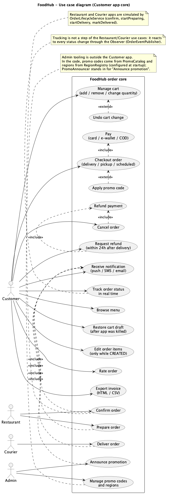

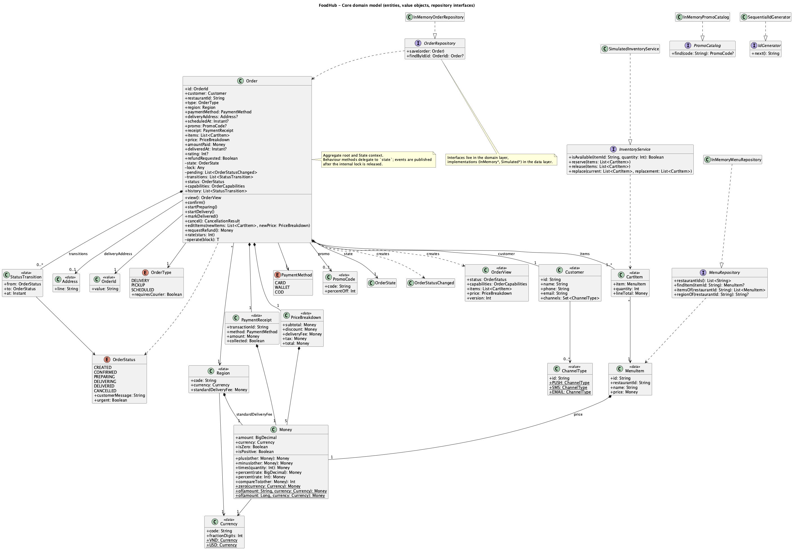

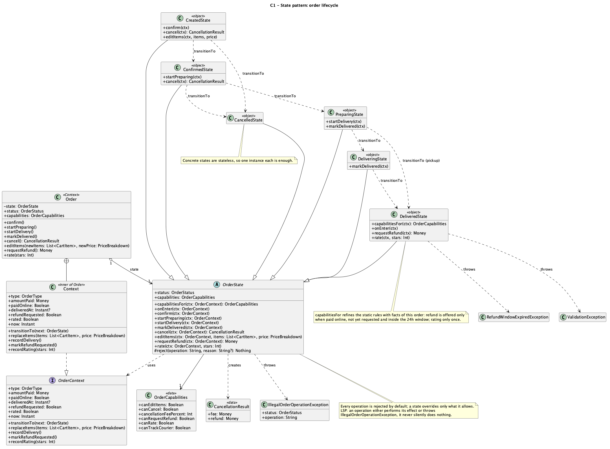

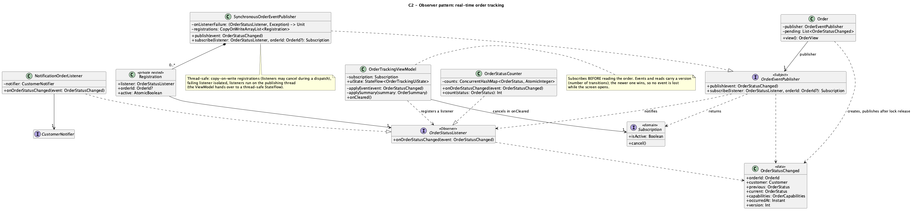

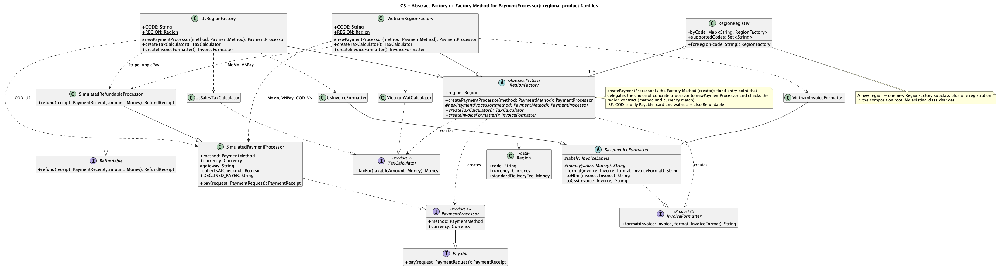

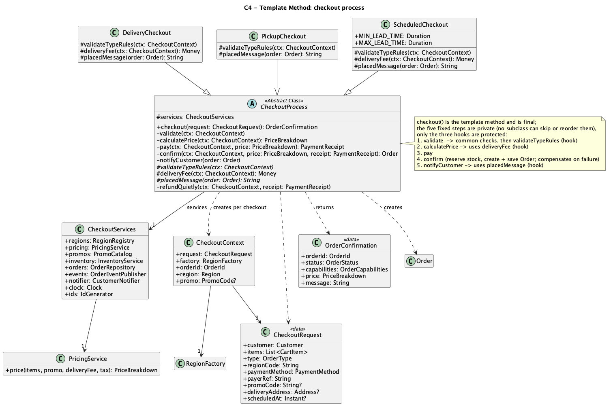

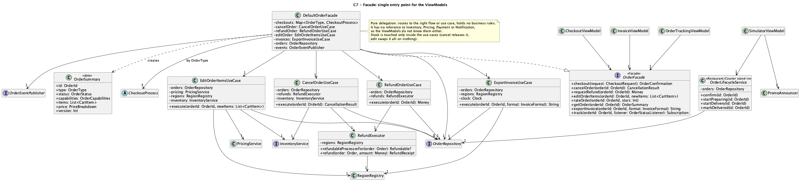

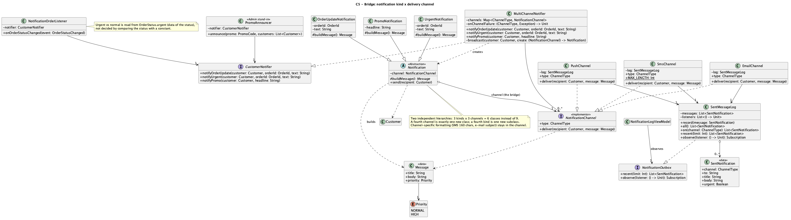

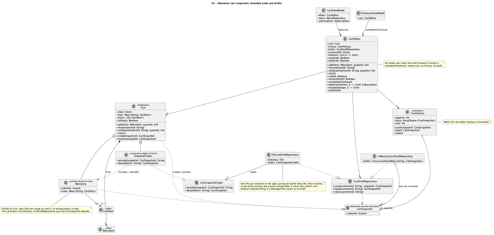

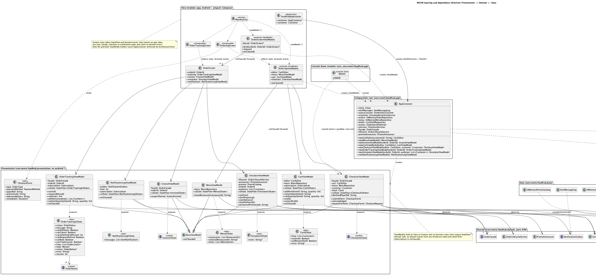

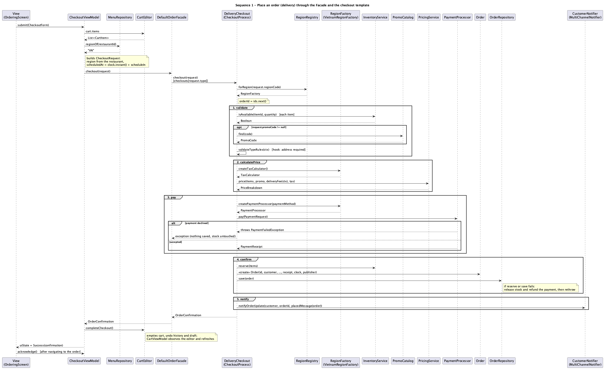

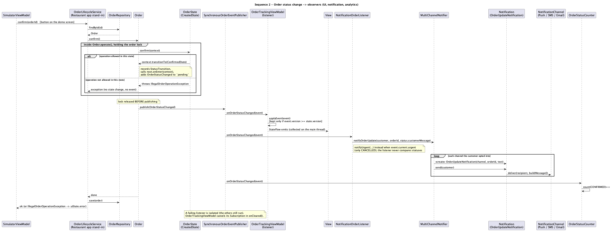

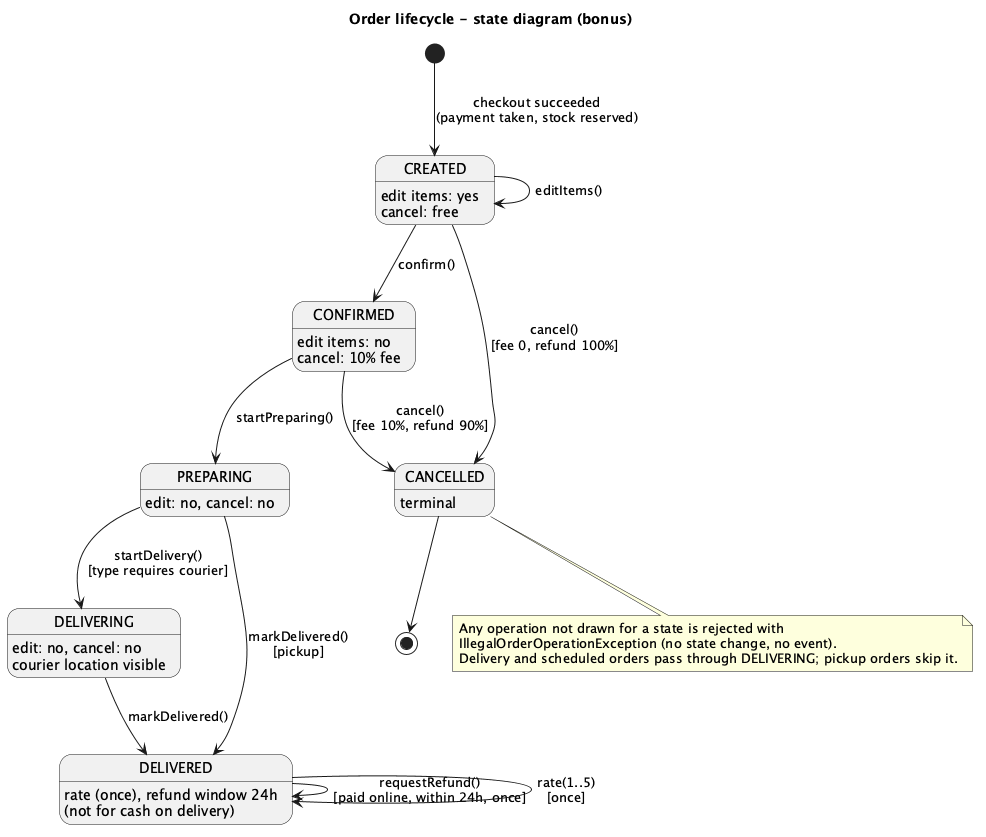

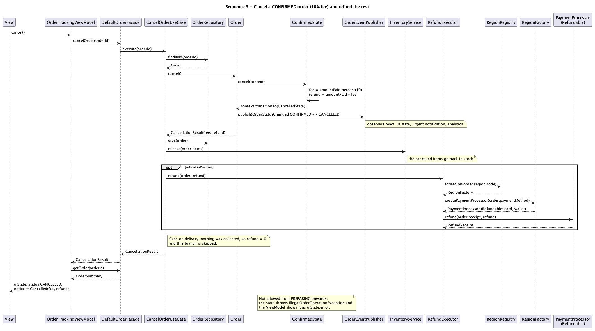

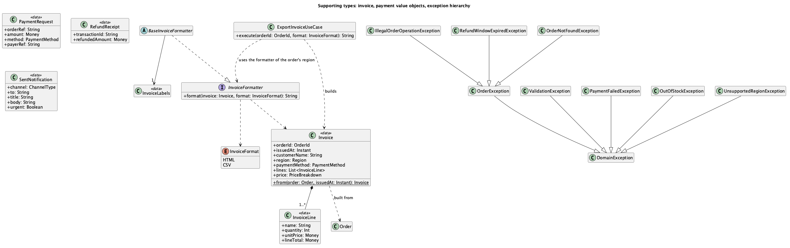
